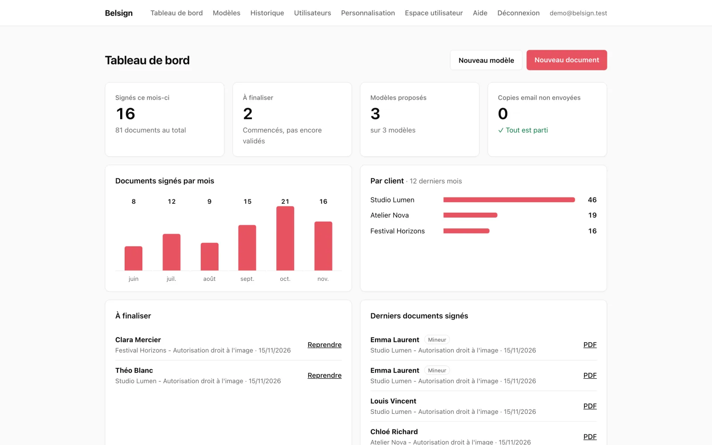
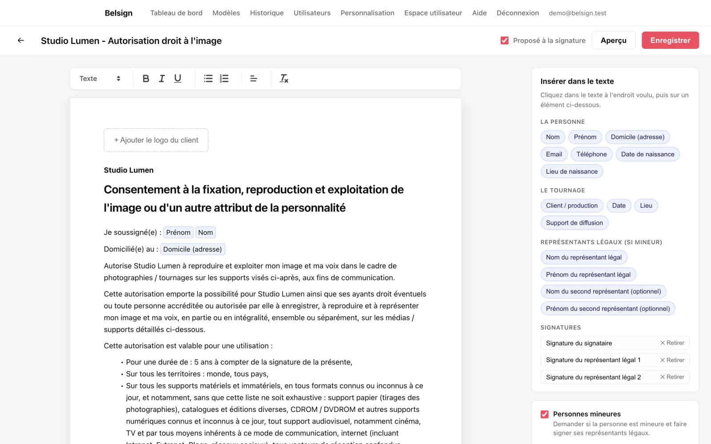

<h1 align="center">
  
</h1>

<p align="center">
  <strong>Les autorisations de droit à l'image, signées sur tablette en deux minutes.</strong><br>
  Open source · Auto-hébergé · Hébergement mutualisé · Licence MIT
</p>

<p align="center">
  <a href="https://github.com/belprod/belsign/releases/latest"></a>
  <a href="LICENSE"></a>
  
</p>

<p align="center">
  <a href="https://belsign.belprod.fr"><strong>Site</strong></a> ·
  <a href="https://github.com/belprod/belsign/releases/latest"><strong>Télécharger</strong></a> ·
  <a href="docs/installation.md"><strong>Installer</strong></a> ·
  <a href="CHANGELOG.md"><strong>Nouveautés</strong></a>
</p>

<p align="center">
  
</p>

---

Belsign remplace les formulaires papier d'autorisation de droit à l'image, sur les tournages comme lors des séances photo :

1. **Choisir le modèle** du client ou de la production.
2. **Remplir** les informations de la personne.
3. **Signer au doigt** sur la tablette, avec les représentants légaux s'il s'agit d'un mineur.
4. **Le PDF est prêt** : daté, classé, archivé et envoyé par email si vous le souhaitez.

> **Ce dépôt** contient la documentation et l'historique des versions de Belsign. **L'application est distribuée en archive prête à installer**, attachée à chaque [version](https://github.com/belprod/belsign/releases). Présentation complète sur [belsign.belprod.fr](https://belsign.belprod.fr).

## Fonctionnalités

| | |
|---|---|
| ✍️ **Signature manuscrite** | Au doigt, au stylet ou à la souris, pensée pour la tablette et le téléphone. |
| 👨‍👩‍👧 **Personnes mineures** | Une case suffit : les représentants légaux sont demandés et signent à leur tour. |
| 📄 **PDF classés par date** | Nommés `AAAA-MM-JJ_Client_Nom_Prénom.pdf` ; figés à la signature, avec empreinte SHA-256. |
| ✉️ **Copie par email** | À la personne qui signe, à l'utilisateur qui fait remplir la fiche, ou aux deux. |
| 📝 **Éditeur de modèles** | On part d'un texte de consentement standard ; champs et signatures s'insèrent en un clic. |
| 📊 **Tableau de bord** | Documents signés par mois et par client, documents à finaliser, historique avec recherche. |
| 🎨 **Personnalisation** | Nom, logo, icône d'onglet et couleur d'accent. |
| 👥 **Équipe illimitée** | Rôles administrateur et utilisateur, sans limite de comptes ni de documents. |

<p align="center">
  
</p>

## Télécharger

Rendez-vous sur la **[page de la dernière version](https://github.com/belprod/belsign/releases/latest)** et téléchargez `belsign-X.Y.Z.zip`. L'empreinte SHA-256 de l'archive est publiée à côté, dans `belsign-X.Y.Z.zip.sha256`.

Raccourci : [belsign.belprod.fr/telecharger](https://belsign.belprod.fr/telecharger).

## Installer

Configuration requise :

- PHP 8.1 ou plus, avec les extensions `pdo_sqlite`, `mbstring`, `intl`, `gd`, `fileinfo` et `dom` ;
- Apache avec `.htaccess`, ce qui est le cas de la quasi-totalité des hébergements mutualisés ;
- un sous-domaine dédié avec certificat SSL.

Aucune base de données à créer : Belsign utilise SQLite.

1. Créez un sous-domaine (par exemple `sign.votre-domaine.fr`) pointé sur le dossier `public/`, et activez le SSL.
2. Décompressez l'archive et envoyez son contenu par FTP.
3. Ouvrez l'adresse dans le navigateur : l'installeur vérifie l'hébergement et crée votre compte administrateur.

Le guide complet, avec la mise à jour, la sauvegarde, la restauration et le dépannage, est dans **[docs/installation.md](docs/installation.md)**.

## Mettre à jour

Téléchargez la nouvelle archive et envoyez-la par FTP en écrasant les fichiers. Vos données et votre configuration ne sont pas touchées, et la base se met à jour automatiquement au premier chargement d'une page.

## Sécurité

Belsign traite des données personnelles, y compris de mineurs. La version 1.0 a fait l'objet d'un audit de sécurité complet. Les mesures intégrées, et ce qui reste à la charge de l'exploitant, sont décrites dans **[docs/securite.md](docs/securite.md)**.

Pour signaler une faille, consultez **[SECURITY.md](SECURITY.md)**.

## Documentation

| Document | Contenu |
|---|---|
| [docs/installation.md](docs/installation.md) | Installation, mise à jour, sauvegarde, restauration, dépannage |
| [docs/securite.md](docs/securite.md) | Mesures de sécurité et recommandations |
| [docs/composants-tiers.md](docs/composants-tiers.md) | Bibliothèques embarquées et leurs licences |
| [CHANGELOG.md](CHANGELOG.md) | Historique des versions |
| Aide intégrée | Dans l'application, menu **Aide** |

## Contenu de ce dépôt

```
docs/                   documentation d'installation et de sécurité, captures
scripts/                publication d'une nouvelle version (mainteneurs)
.github/                modèles de tickets
CHANGELOG.md            historique des versions
SECURITY.md             signalement des failles
```

### Publier une nouvelle version (mainteneurs)

Depuis les sources de l'application, construisez l'archive (`bash scripts/build-dist.sh`), puis lancez depuis ce dépôt :

```bash
bash scripts/publier-version.sh /chemin/vers/les-sources
```

Le script :

1. synchronise le changelog et la documentation ;
2. commite et crée le tag `vX.Y.Z` ;
3. publie la version GitHub avec l'archive, son empreinte et les notes tirées du changelog.

Il ne pousse rien sans confirmation.

## Licence

Belsign est distribué sous licence [MIT](LICENSE) © 2026 Belprod.
